# Purpose

Follow up from [UCLR-165](https://github.com/UltraclearRepos/US_segmentation/tree/UCLR-165)

Research on whether adding more context of frame spacing can help model. Input changed from duplicated x3 the same US frame to [previous_frame, current_frame, next_frame], prediction was made for current frame

# General

Model was trained on data: [TG3K](https://github.com/openmedlab/Awesome-Medical-Dataset/blob/main/resources/TG3K.md), [SegThy](https://www.cs.cit.tum.de/en/camp/publications/segthy-dataset) and our data collected with PIUR: [PIUR_dataset](https://huggingface.co/datasets/Ultraclear/PIUR_Thyroid_segmentation)

Model was evaluated on each patient from [PIUR_dataset](https://huggingface.co/datasets/Ultraclear/PIUR_Thyroid_segmentation) separately with exluding this data from training subset

# Results

## Dice
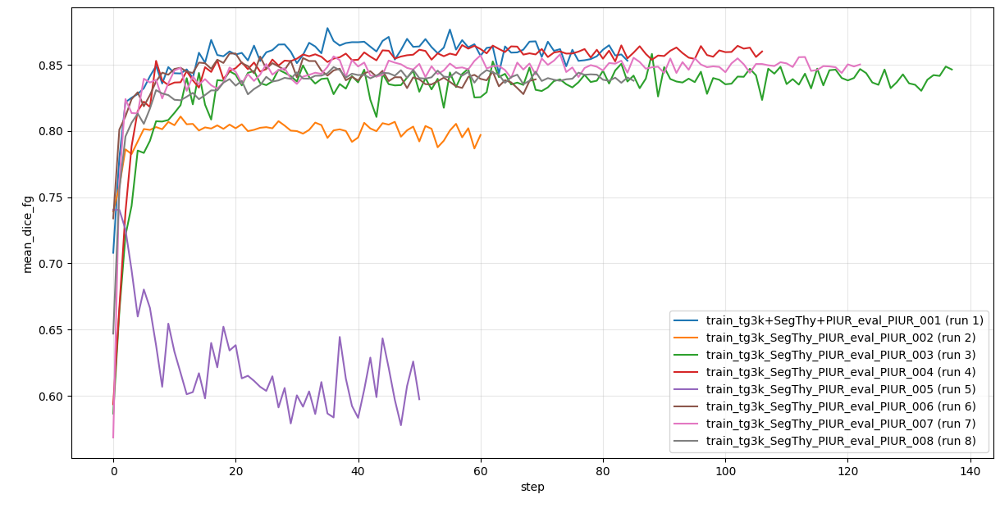

## Training loss
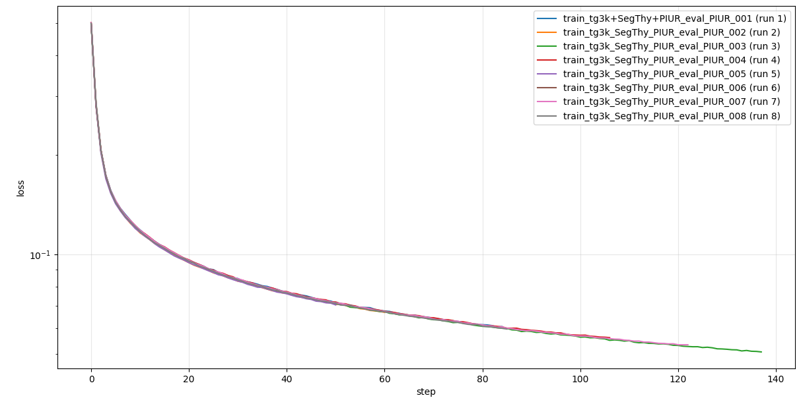

## Validation loss
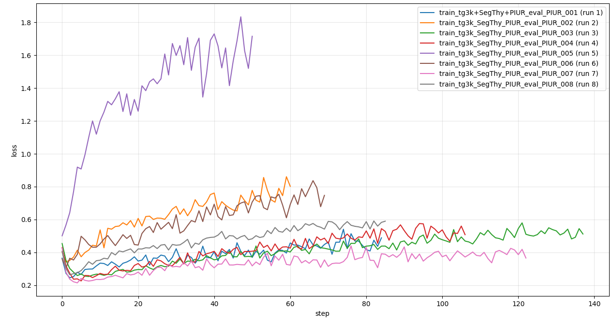


# Results comparing to [UCLR-165](https://github.com/UltraclearRepos/US_segmentation/tree/UCLR-165)

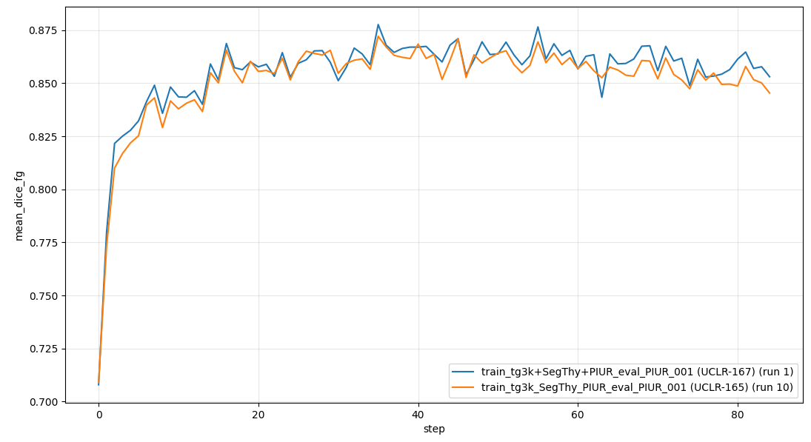
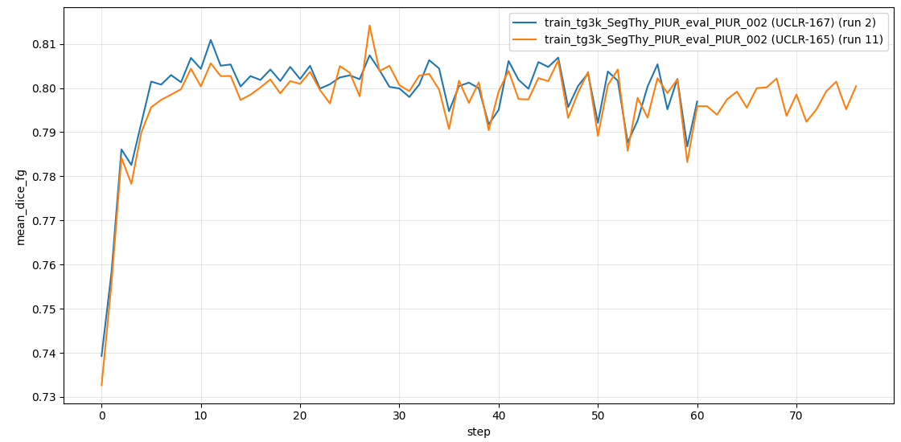
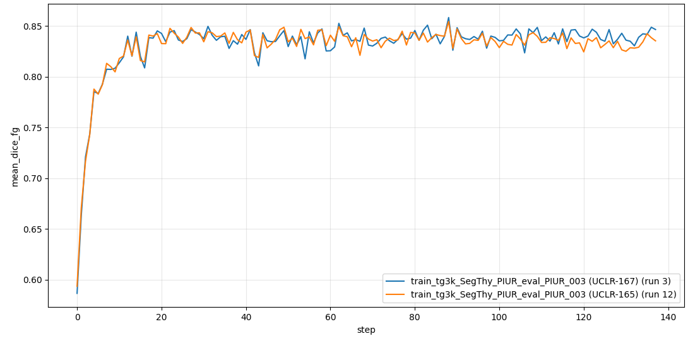
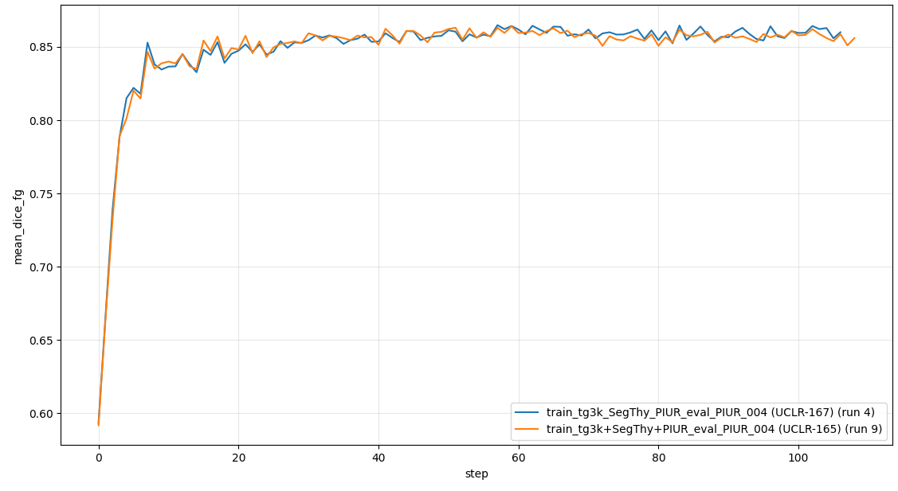
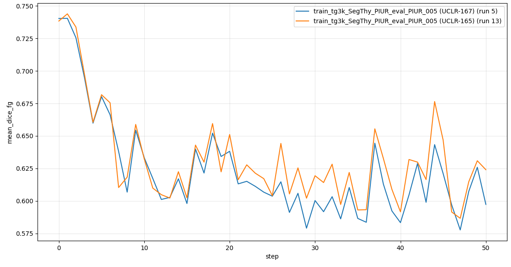
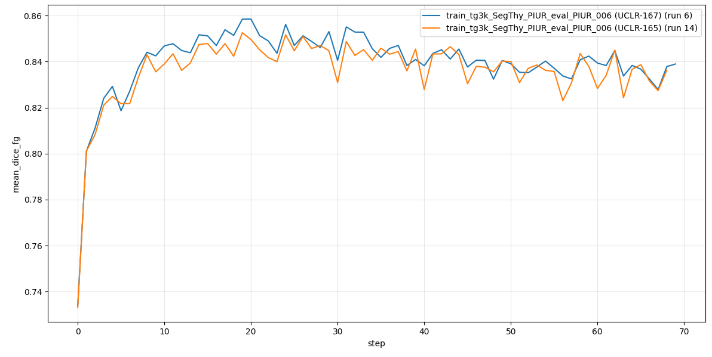
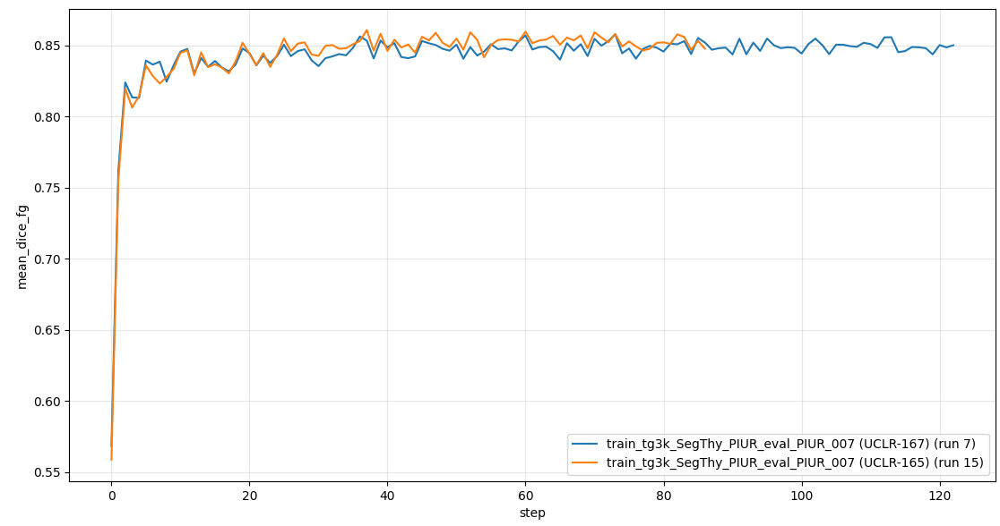
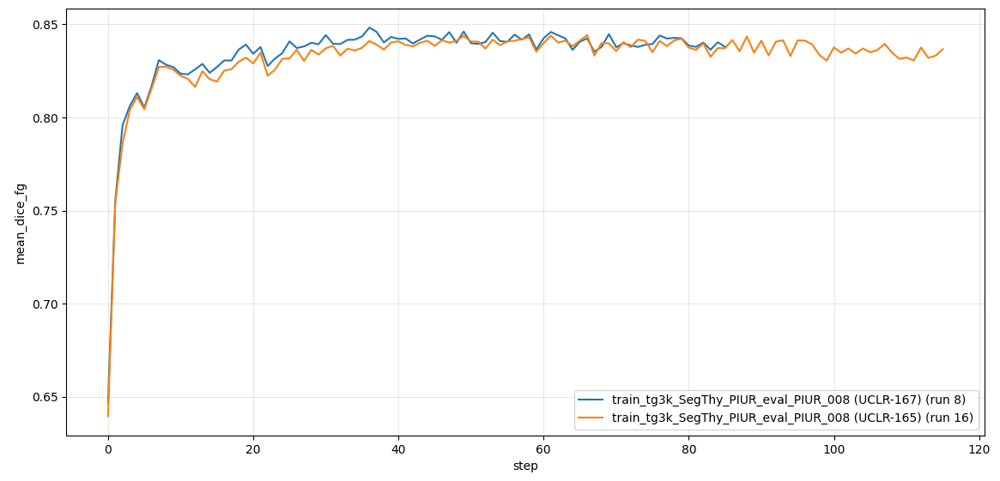

# Configs

## Run 1
<details>
    <summary>Show configuration</summary>

```json
{
  "run_name": 1,
  "datasets": {
    "split": {
      "thyroid": [
        "data/prepared/PIUR_dataset_axial_001"
      ]
    },
    "train": {
      "thyroid": [
        "data/prepared/tg3k",
        "data/prepared/SegThy_dataset_axial"
      ]
    },
    "val": {}
  },
  "paths": {
    "output_root": "outputs",
    "input_checkpoint": "input_checkpoints/best_model.pth"
  },
  "data": {
    "image_size": [
      256,
      256
    ],
    "augmentation": {
      "enabled": true,
      "flip": {
        "probability": 0.5
      },
      "rotation": {
        "probability": 0.5,
        "max_angle": 10
      },
      "intensity": {
        "probability": 0.5,
        "scale_min": 0.9,
        "scale_max": 1.1,
        "shift": 0.05
      },

      "gamma": {
        "probability": 0.3,
        "min_gamma": 0.8,
        "max_gamma": 1.2
      },

      "noise": {
        "probability": 0.25,
        "sigma": 0.05
      },

      "gaussian_blur": {
        "probability": 0.15,
        "min_radius": 0.3,
        "max_radius": 1.0
      }
    }
  },
  "model": {
    "in_channels": 3,
    "bilinear": true
  },
  "training": {
    "seed": 42,
    "batch_size": 8,
    "num_workers": 2,
    "pin_memory": true,
    "epochs": 200,
    "learning_rate": 0.00001,
    "weight_decay": 0.0001
  },
  "loss": {
    "class_weight_power": 1.0,
    "lambda": 0.5,
    "smooth": 1e-6
  },
  "tensorboard": {
    "log_every_n_steps": 10
  },
  "callbacks": {
    "monitor": "val/mean_dice_fg",
    "early_stopping": {
      "enabled": true,
      "patience": 50,
      "min_delta": 0.0
    }
  }
}

```
</details>

## Run 2
<details>
    <summary>Show configuration</summary>

```json
{
  "run_name": 2,
  "datasets": {
    "split": {
      "thyroid": [
        "data/prepared/PIUR_dataset_axial_002"
      ]
    },
    "train": {
      "thyroid": [
        "data/prepared/tg3k",
        "data/prepared/SegThy_dataset_axial"
      ]
    },
    "val": {}
  },
  "paths": {
    "output_root": "outputs",
    "input_checkpoint": "input_checkpoints/best_model.pth"
  },
  "data": {
    "image_size": [
      256,
      256
    ],
    "augmentation": {
      "enabled": true,
      "flip": {
        "probability": 0.5
      },
      "rotation": {
        "probability": 0.5,
        "max_angle": 10
      },
      "intensity": {
        "probability": 0.5,
        "scale_min": 0.9,
        "scale_max": 1.1,
        "shift": 0.05
      },

      "gamma": {
        "probability": 0.3,
        "min_gamma": 0.8,
        "max_gamma": 1.2
      },

      "noise": {
        "probability": 0.25,
        "sigma": 0.05
      },

      "gaussian_blur": {
        "probability": 0.15,
        "min_radius": 0.3,
        "max_radius": 1.0
      }
    }
  },
  "model": {
    "in_channels": 3,
    "bilinear": true
  },
  "training": {
    "seed": 42,
    "batch_size": 8,
    "num_workers": 2,
    "pin_memory": true,
    "epochs": 200,
    "learning_rate": 0.00001,
    "weight_decay": 0.0001
  },
  "loss": {
    "class_weight_power": 1.0,
    "lambda": 0.5,
    "smooth": 1e-6
  },
  "tensorboard": {
    "log_every_n_steps": 10
  },
  "callbacks": {
    "monitor": "val/mean_dice_fg",
    "early_stopping": {
      "enabled": true,
      "patience": 50,
      "min_delta": 0.0
    }
  }
}

```
</details>

## Run 3
<details>
    <summary>Show configuration</summary>

```json
{
  "run_name": 3,
  "datasets": {
    "split": {
      "thyroid": [
        "data/prepared/PIUR_dataset_axial_003"
      ]
    },
    "train": {
      "thyroid": [
        "data/prepared/tg3k",
        "data/prepared/SegThy_dataset_axial"
      ]
    },
    "val": {}
  },
  "paths": {
    "output_root": "outputs",
    "input_checkpoint": "input_checkpoints/best_model.pth"
  },
  "data": {
    "image_size": [
      256,
      256
    ],
    "augmentation": {
      "enabled": true,
      "flip": {
        "probability": 0.5
      },
      "rotation": {
        "probability": 0.5,
        "max_angle": 10
      },
      "intensity": {
        "probability": 0.5,
        "scale_min": 0.9,
        "scale_max": 1.1,
        "shift": 0.05
      },

      "gamma": {
        "probability": 0.3,
        "min_gamma": 0.8,
        "max_gamma": 1.2
      },

      "noise": {
        "probability": 0.25,
        "sigma": 0.05
      },

      "gaussian_blur": {
        "probability": 0.15,
        "min_radius": 0.3,
        "max_radius": 1.0
      }
    }
  },
  "model": {
    "in_channels": 3,
    "bilinear": true
  },
  "training": {
    "seed": 42,
    "batch_size": 8,
    "num_workers": 2,
    "pin_memory": true,
    "epochs": 200,
    "learning_rate": 0.00001,
    "weight_decay": 0.0001
  },
  "loss": {
    "class_weight_power": 1.0,
    "lambda": 0.5,
    "smooth": 1e-6
  },
  "tensorboard": {
    "log_every_n_steps": 10
  },
  "callbacks": {
    "monitor": "val/mean_dice_fg",
    "early_stopping": {
      "enabled": true,
      "patience": 50,
      "min_delta": 0.0
    }
  }
}

```
</details>

## Run 4
<details>
    <summary>Show configuration</summary>

```json
{
  "run_name": 4,
  "datasets": {
    "split": {
      "thyroid": [
        "data/prepared/PIUR_dataset_axial_004"
      ]
    },
    "train": {
      "thyroid": [
        "data/prepared/tg3k",
        "data/prepared/SegThy_dataset_axial"
      ]
    },
    "val": {}
  },
  "paths": {
    "output_root": "outputs",
    "input_checkpoint": "input_checkpoints/best_model.pth"
  },
  "data": {
    "image_size": [
      256,
      256
    ],
    "augmentation": {
      "enabled": true,
      "flip": {
        "probability": 0.5
      },
      "rotation": {
        "probability": 0.5,
        "max_angle": 10
      },
      "intensity": {
        "probability": 0.5,
        "scale_min": 0.9,
        "scale_max": 1.1,
        "shift": 0.05
      },

      "gamma": {
        "probability": 0.3,
        "min_gamma": 0.8,
        "max_gamma": 1.2
      },

      "noise": {
        "probability": 0.25,
        "sigma": 0.05
      },

      "gaussian_blur": {
        "probability": 0.15,
        "min_radius": 0.3,
        "max_radius": 1.0
      }
    }
  },
  "model": {
    "in_channels": 3,
    "bilinear": true
  },
  "training": {
    "seed": 42,
    "batch_size": 8,
    "num_workers": 2,
    "pin_memory": true,
    "epochs": 200,
    "learning_rate": 0.00001,
    "weight_decay": 0.0001
  },
  "loss": {
    "class_weight_power": 1.0,
    "lambda": 0.5,
    "smooth": 1e-6
  },
  "tensorboard": {
    "log_every_n_steps": 10
  },
  "callbacks": {
    "monitor": "val/mean_dice_fg",
    "early_stopping": {
      "enabled": true,
      "patience": 50,
      "min_delta": 0.0
    }
  }
}

```
</details>

## Run 5
<details>
    <summary>Show configuration</summary>

```json
{
  "run_name": 5,
  "datasets": {
    "split": {
      "thyroid": [
        "data/prepared/PIUR_dataset_axial_005"
      ]
    },
    "train": {
      "thyroid": [
        "data/prepared/tg3k",
        "data/prepared/SegThy_dataset_axial"
      ]
    },
    "val": {}
  },
  "paths": {
    "output_root": "outputs",
    "input_checkpoint": "input_checkpoints/best_model.pth"
  },
  "data": {
    "image_size": [
      256,
      256
    ],
    "augmentation": {
      "enabled": true,
      "flip": {
        "probability": 0.5
      },
      "rotation": {
        "probability": 0.5,
        "max_angle": 10
      },
      "intensity": {
        "probability": 0.5,
        "scale_min": 0.9,
        "scale_max": 1.1,
        "shift": 0.05
      },

      "gamma": {
        "probability": 0.3,
        "min_gamma": 0.8,
        "max_gamma": 1.2
      },

      "noise": {
        "probability": 0.25,
        "sigma": 0.05
      },

      "gaussian_blur": {
        "probability": 0.15,
        "min_radius": 0.3,
        "max_radius": 1.0
      }
    }
  },
  "model": {
    "in_channels": 3,
    "bilinear": true
  },
  "training": {
    "seed": 42,
    "batch_size": 8,
    "num_workers": 2,
    "pin_memory": true,
    "epochs": 200,
    "learning_rate": 0.00001,
    "weight_decay": 0.0001
  },
  "loss": {
    "class_weight_power": 1.0,
    "lambda": 0.5,
    "smooth": 1e-6
  },
  "tensorboard": {
    "log_every_n_steps": 10
  },
  "callbacks": {
    "monitor": "val/mean_dice_fg",
    "early_stopping": {
      "enabled": true,
      "patience": 50,
      "min_delta": 0.0
    }
  }
}

```
</details>

## Run 6
<details>
    <summary>Show configuration</summary>

```json
{
  "run_name": 6,
  "datasets": {
    "split": {
      "thyroid": [
        "data/prepared/PIUR_dataset_axial_006"
      ]
    },
    "train": {
      "thyroid": [
        "data/prepared/tg3k",
        "data/prepared/SegThy_dataset_axial"
      ]
    },
    "val": {}
  },
  "paths": {
    "output_root": "outputs",
    "input_checkpoint": "input_checkpoints/best_model.pth"
  },
  "data": {
    "image_size": [
      256,
      256
    ],
    "augmentation": {
      "enabled": true,
      "flip": {
        "probability": 0.5
      },
      "rotation": {
        "probability": 0.5,
        "max_angle": 10
      },
      "intensity": {
        "probability": 0.5,
        "scale_min": 0.9,
        "scale_max": 1.1,
        "shift": 0.05
      },

      "gamma": {
        "probability": 0.3,
        "min_gamma": 0.8,
        "max_gamma": 1.2
      },

      "noise": {
        "probability": 0.25,
        "sigma": 0.05
      },

      "gaussian_blur": {
        "probability": 0.15,
        "min_radius": 0.3,
        "max_radius": 1.0
      }
    }
  },
  "model": {
    "in_channels": 3,
    "bilinear": true
  },
  "training": {
    "seed": 42,
    "batch_size": 8,
    "num_workers": 2,
    "pin_memory": true,
    "epochs": 200,
    "learning_rate": 0.00001,
    "weight_decay": 0.0001
  },
  "loss": {
    "class_weight_power": 1.0,
    "lambda": 0.5,
    "smooth": 1e-6
  },
  "tensorboard": {
    "log_every_n_steps": 10
  },
  "callbacks": {
    "monitor": "val/mean_dice_fg",
    "early_stopping": {
      "enabled": true,
      "patience": 50,
      "min_delta": 0.0
    }
  }
}

```
</details>

## Run 7
<details>
    <summary>Show configuration</summary>

```json
{
  "run_name": 7,
  "datasets": {
    "split": {
      "thyroid": [
        "data/prepared/PIUR_dataset_axial_007"
      ]
    },
    "train": {
      "thyroid": [
        "data/prepared/tg3k",
        "data/prepared/SegThy_dataset_axial"
      ]
    },
    "val": {}
  },
  "paths": {
    "output_root": "outputs",
    "input_checkpoint": "input_checkpoints/best_model.pth"
  },
  "data": {
    "image_size": [
      256,
      256
    ],
    "augmentation": {
      "enabled": true,
      "flip": {
        "probability": 0.5
      },
      "rotation": {
        "probability": 0.5,
        "max_angle": 10
      },
      "intensity": {
        "probability": 0.5,
        "scale_min": 0.9,
        "scale_max": 1.1,
        "shift": 0.05
      },

      "gamma": {
        "probability": 0.3,
        "min_gamma": 0.8,
        "max_gamma": 1.2
      },

      "noise": {
        "probability": 0.25,
        "sigma": 0.05
      },

      "gaussian_blur": {
        "probability": 0.15,
        "min_radius": 0.3,
        "max_radius": 1.0
      }
    }
  },
  "model": {
    "in_channels": 3,
    "bilinear": true
  },
  "training": {
    "seed": 42,
    "batch_size": 8,
    "num_workers": 2,
    "pin_memory": true,
    "epochs": 200,
    "learning_rate": 0.00001,
    "weight_decay": 0.0001
  },
  "loss": {
    "class_weight_power": 1.0,
    "lambda": 0.5,
    "smooth": 1e-6
  },
  "tensorboard": {
    "log_every_n_steps": 10
  },
  "callbacks": {
    "monitor": "val/mean_dice_fg",
    "early_stopping": {
      "enabled": true,
      "patience": 50,
      "min_delta": 0.0
    }
  }
}

```
</details>

## Run 8
<details>
    <summary>Show configuration</summary>

```json
{
  "run_name": 8,
  "datasets": {
    "split": {
      "thyroid": [
        "data/prepared/PIUR_dataset_axial_008"
      ]
    },
    "train": {
      "thyroid": [
        "data/prepared/tg3k",
        "data/prepared/SegThy_dataset_axial"
      ]
    },
    "val": {}
  },
  "paths": {
    "output_root": "outputs",
    "input_checkpoint": "input_checkpoints/best_model.pth"
  },
  "data": {
    "image_size": [
      256,
      256
    ],
    "augmentation": {
      "enabled": true,
      "flip": {
        "probability": 0.5
      },
      "rotation": {
        "probability": 0.5,
        "max_angle": 10
      },
      "intensity": {
        "probability": 0.5,
        "scale_min": 0.9,
        "scale_max": 1.1,
        "shift": 0.05
      },

      "gamma": {
        "probability": 0.3,
        "min_gamma": 0.8,
        "max_gamma": 1.2
      },

      "noise": {
        "probability": 0.25,
        "sigma": 0.05
      },

      "gaussian_blur": {
        "probability": 0.15,
        "min_radius": 0.3,
        "max_radius": 1.0
      }
    }
  },
  "model": {
    "in_channels": 3,
    "bilinear": true
  },
  "training": {
    "seed": 42,
    "batch_size": 8,
    "num_workers": 2,
    "pin_memory": true,
    "epochs": 200,
    "learning_rate": 0.00001,
    "weight_decay": 0.0001
  },
  "loss": {
    "class_weight_power": 1.0,
    "lambda": 0.5,
    "smooth": 1e-6
  },
  "tensorboard": {
    "log_every_n_steps": 10
  },
  "callbacks": {
    "monitor": "val/mean_dice_fg",
    "early_stopping": {
      "enabled": true,
      "patience": 50,
      "min_delta": 0.0
    }
  }
}

```
</details>