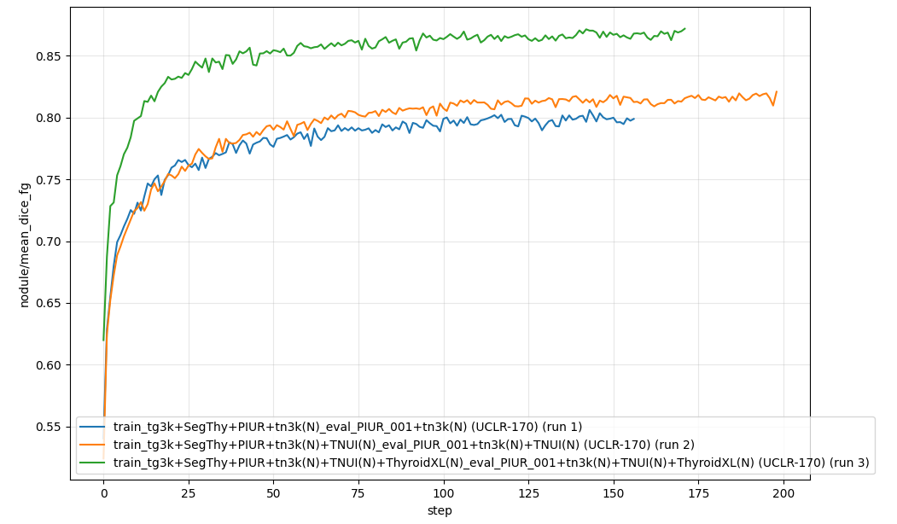
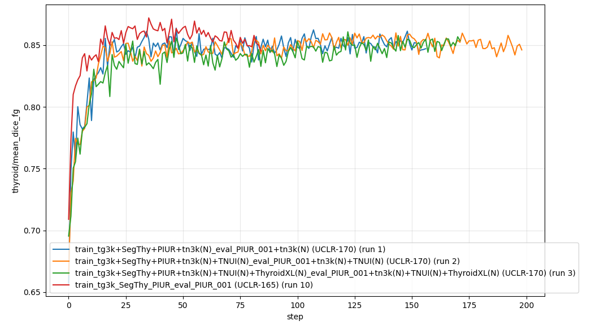
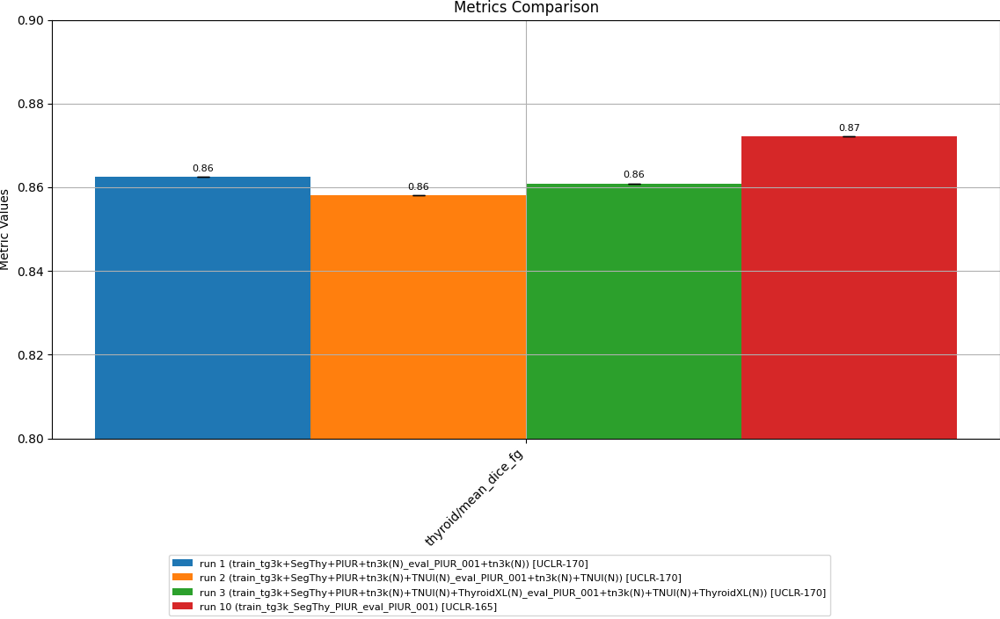
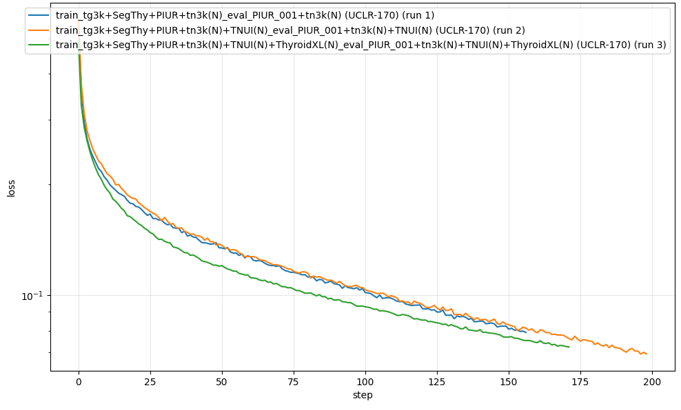
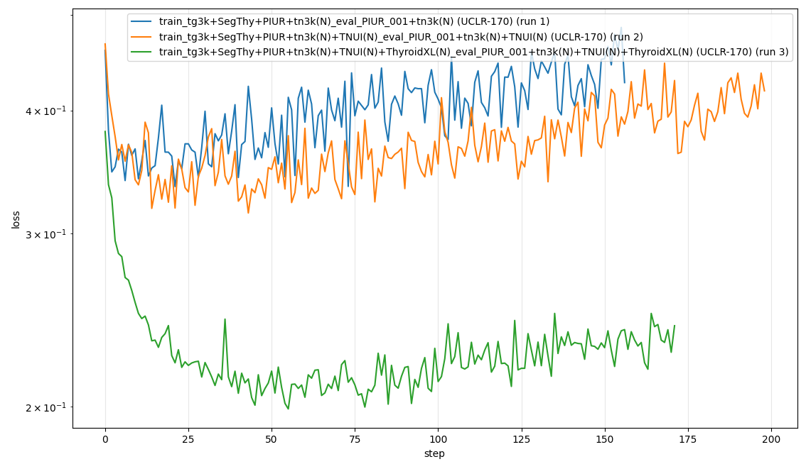
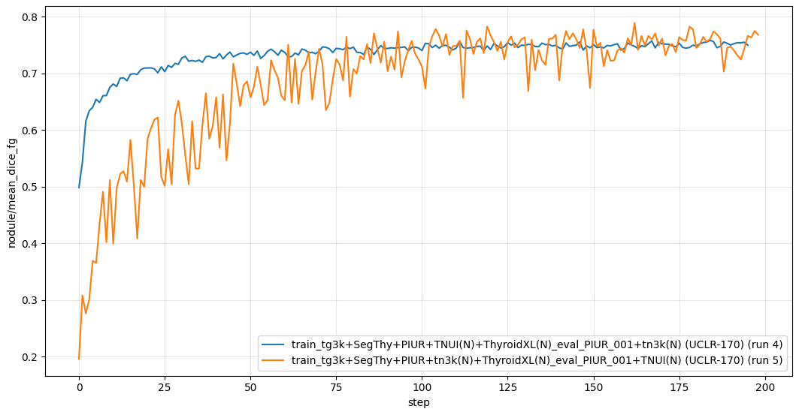
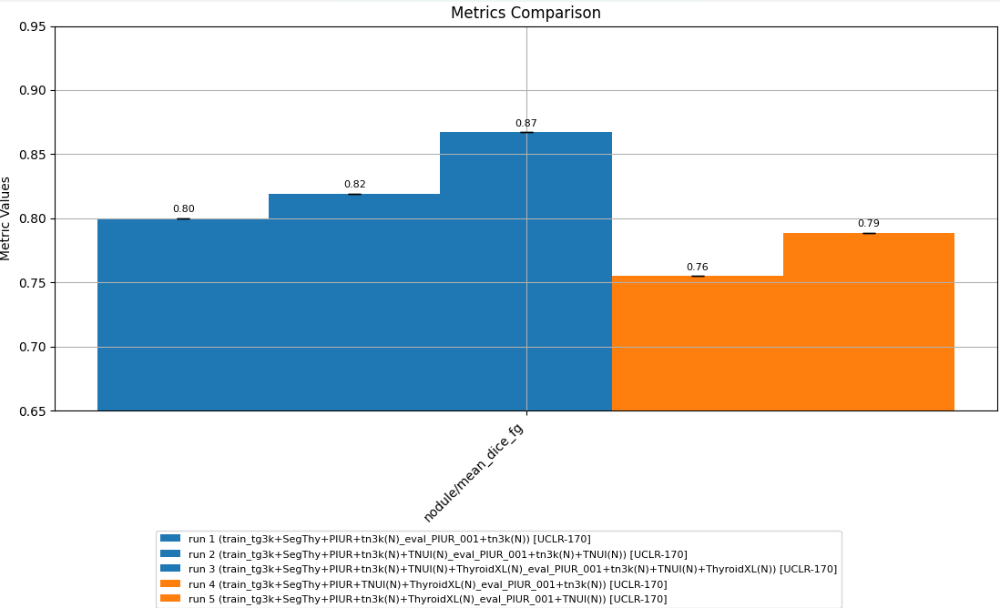

# Purpose

Research on nodule segmentation, whether it can be done using same model as for thyroid segmentation, and if this preserve thyroid segmentation quality.

# General

Model was trained on data: [TN3k](https://www.kaggle.com/datasets/tjahan/tn3k-thyroid-nodule-region-segmentation-dataset), [TNUI_2021](https://github.com/zxg3017/TNUI-2021-), [ThyroidXL](https://huggingface.co/datasets/VNPT-AI/ThyroidXL). Evaluated on subsets of datasets above.

For thyroid same datasets as in [UCLR-165](https://github.com/UltraclearRepos/US_segmentation/tree/UCLR-165) were used.

# Results

## Nodule dice




## Thyroid dice




Thyroid gland dice was preserved comparing to [UCLR-165](https://github.com/UltraclearRepos/US_segmentation/tree/UCLR-165) run where model was trained only for thyroid segmentation.


## Training loss



## Validation loss




# Results on model generalization

For model training [ThyroidXL](https://huggingface.co/datasets/VNPT-AI/ThyroidXL) was always used. And rest 2 datasets was used separately for training and validation. Therefore model did not see any examples from validation dataset in training procedure.




The model performance for nodule segmentation was only slightly worse then for runs (1, 2, 3) where model saw datasets samples in training and validation


# Configs

## Run 1
<details>
    <summary>Show configuration</summary>

```json
{
  "run_name": 1,
  "datasets": {
    "split": {
      "thyroid": [
        "data/prepared/PIUR_dataset_axial_001"
      ],
      "nodule": [
        "data/prepared/tn3k"
      ]
    },
    "train": {
      "thyroid": [
        "data/prepared/tg3k",
        "data/prepared/SegThy_dataset_axial"
      ]
    },
    "val": {}
  },
  "paths": {
    "output_root": "outputs",
    "input_checkpoint": "input_checkpoints/best_model.pth"
  },
  "data": {
    "image_size": [
      256,
      256
    ],
    "augmentation": {
      "enabled": true,
      "flip": {
        "probability": 0.5
      },
      "rotation": {
        "probability": 0.5,
        "max_angle": 10
      },
      "intensity": {
        "probability": 0.5,
        "scale_min": 0.9,
        "scale_max": 1.1,
        "shift": 0.05
      },

      "gamma": {
        "probability": 0.3,
        "min_gamma": 0.8,
        "max_gamma": 1.2
      },

      "noise": {
        "probability": 0.25,
        "sigma": 0.05
      },

      "gaussian_blur": {
        "probability": 0.15,
        "min_radius": 0.3,
        "max_radius": 1.0
      }
    }
  },
  "model": {
    "in_channels": 3,
    "bilinear": true
  },
  "training": {
    "seed": 42,
    "batch_size": 8,
    "num_workers": 2,
    "pin_memory": true,
    "epochs": 200,
    "learning_rate": 0.00001,
    "weight_decay": 0.0001
  },
  "loss": {
    "class_weight_power": 1.0,
    "lambda": 0.5,
    "smooth": 1e-6
  },
  "tensorboard": {
    "log_every_n_steps": 10
  },
  "callbacks": {
    "monitor": "val/mean_dice_fg",
    "early_stopping": {
      "enabled": true,
      "patience": 50,
      "min_delta": 0.0
    }
  }
}

```
</details>

## Run 2
<details>
    <summary>Show configuration</summary>

```json
{
  "run_name": 2,
  "datasets": {
    "split": {
      "thyroid": [
        "data/prepared/PIUR_dataset_axial_001"
      ],
      "nodule": [
        "data/prepared/tn3k",
        "data/prepared/TNUI_2021_dataset"
      ]
    },
    "train": {
      "thyroid": [
        "data/prepared/tg3k",
        "data/prepared/SegThy_dataset_axial"
      ]
    },
    "val": {}
  },
  "paths": {
    "output_root": "outputs",
    "input_checkpoint": "input_checkpoints/best_model.pth"
  },
  "data": {
    "image_size": [
      256,
      256
    ],
    "augmentation": {
      "enabled": true,
      "flip": {
        "probability": 0.5
      },
      "rotation": {
        "probability": 0.5,
        "max_angle": 10
      },
      "intensity": {
        "probability": 0.5,
        "scale_min": 0.9,
        "scale_max": 1.1,
        "shift": 0.05
      },

      "gamma": {
        "probability": 0.3,
        "min_gamma": 0.8,
        "max_gamma": 1.2
      },

      "noise": {
        "probability": 0.25,
        "sigma": 0.05
      },

      "gaussian_blur": {
        "probability": 0.15,
        "min_radius": 0.3,
        "max_radius": 1.0
      }
    }
  },
  "model": {
    "in_channels": 3,
    "bilinear": true
  },
  "training": {
    "seed": 42,
    "batch_size": 8,
    "num_workers": 2,
    "pin_memory": true,
    "epochs": 200,
    "learning_rate": 0.00001,
    "weight_decay": 0.0001
  },
  "loss": {
    "class_weight_power": 1.0,
    "lambda": 0.5,
    "smooth": 1e-6
  },
  "tensorboard": {
    "log_every_n_steps": 10
  },
  "callbacks": {
    "monitor": "val/mean_dice_fg",
    "early_stopping": {
      "enabled": true,
      "patience": 50,
      "min_delta": 0.0
    }
  }
}

```
</details>

## Run 3
<details>
    <summary>Show configuration</summary>

```json
{
  "run_name": 3,
  "datasets": {
    "split": {
      "thyroid": [
        "data/prepared/PIUR_dataset_axial_001"
      ],
      "nodule": [
        "data/prepared/tn3k",
        "data/prepared/TNUI_2021_dataset",
        "data/prepared/ThyroidXL_dataset"
      ]
    },
    "train": {
      "thyroid": [
        "data/prepared/tg3k",
        "data/prepared/SegThy_dataset_axial"
      ]
    },
    "val": {}
  },
  "paths": {
    "output_root": "outputs",
    "input_checkpoint": "input_checkpoints/best_model.pth"
  },
  "data": {
    "image_size": [
      256,
      256
    ],
    "augmentation": {
      "enabled": true,
      "flip": {
        "probability": 0.5
      },
      "rotation": {
        "probability": 0.5,
        "max_angle": 10
      },
      "intensity": {
        "probability": 0.5,
        "scale_min": 0.9,
        "scale_max": 1.1,
        "shift": 0.05
      },

      "gamma": {
        "probability": 0.3,
        "min_gamma": 0.8,
        "max_gamma": 1.2
      },

      "noise": {
        "probability": 0.25,
        "sigma": 0.05
      },

      "gaussian_blur": {
        "probability": 0.15,
        "min_radius": 0.3,
        "max_radius": 1.0
      }
    }
  },
  "model": {
    "in_channels": 3,
    "bilinear": true
  },
  "training": {
    "seed": 42,
    "batch_size": 8,
    "num_workers": 2,
    "pin_memory": true,
    "epochs": 200,
    "learning_rate": 0.00001,
    "weight_decay": 0.0001
  },
  "loss": {
    "class_weight_power": 1.0,
    "lambda": 0.5,
    "smooth": 1e-6
  },
  "tensorboard": {
    "log_every_n_steps": 10
  },
  "callbacks": {
    "monitor": "val/mean_dice_fg",
    "early_stopping": {
      "enabled": true,
      "patience": 50,
      "min_delta": 0.0
    }
  }
}

```
</details>

## Run 4
<details>
    <summary>Show configuration</summary>

```json
{
  "run_name": 4,
  "datasets": {
    "split": {
      "thyroid": [
        "data/prepared/PIUR_dataset_axial_001"
      ]
    },
    "train": {
      "thyroid": [
        "data/prepared/tg3k",
        "data/prepared/SegThy_dataset_axial"
      ],
      "nodule": [
        "data/prepared/TNUI_2021_dataset",
        "data/prepared/ThyroidXL_dataset"
      ]
    },
    "val": {
      "nodule": [
        "data/prepared/tn3k"
      ]
    }
  },
  "paths": {
    "output_root": "outputs",
    "input_checkpoint": "input_checkpoints/best_model.pth"
  },
  "data": {
    "image_size": [
      256,
      256
    ],
    "augmentation": {
      "enabled": true,
      "flip": {
        "probability": 0.5
      },
      "rotation": {
        "probability": 0.5,
        "max_angle": 10
      },
      "intensity": {
        "probability": 0.5,
        "scale_min": 0.9,
        "scale_max": 1.1,
        "shift": 0.05
      },

      "gamma": {
        "probability": 0.3,
        "min_gamma": 0.8,
        "max_gamma": 1.2
      },

      "noise": {
        "probability": 0.25,
        "sigma": 0.05
      },

      "gaussian_blur": {
        "probability": 0.15,
        "min_radius": 0.3,
        "max_radius": 1.0
      }
    }
  },
  "model": {
    "in_channels": 3,
    "bilinear": true
  },
  "training": {
    "seed": 42,
    "batch_size": 8,
    "num_workers": 2,
    "pin_memory": true,
    "epochs": 200,
    "learning_rate": 0.00001,
    "weight_decay": 0.0001
  },
  "loss": {
    "class_weight_power": 1.0,
    "lambda": 0.5,
    "smooth": 1e-6
  },
  "tensorboard": {
    "log_every_n_steps": 10
  },
  "callbacks": {
    "monitor": "val/mean_dice_fg",
    "early_stopping": {
      "enabled": true,
      "patience": 50,
      "min_delta": 0.0
    }
  }
}

```
</details>

## Run 5
<details>
    <summary>Show configuration</summary>

```json
{
  "run_name": 5,
  "datasets": {
    "split": {
      "thyroid": [
        "data/prepared/PIUR_dataset_axial_001"
      ]
    },
    "train": {
      "thyroid": [
        "data/prepared/tg3k",
        "data/prepared/SegThy_dataset_axial"
      ],
      "nodule": [
        "data/prepared/tn3k",
        "data/prepared/ThyroidXL_dataset"
      ]
    },
    "val": {
      "nodule": [
        "data/prepared/TNUI_2021_dataset"
      ]
    }
  },
  "paths": {
    "output_root": "outputs",
    "input_checkpoint": "input_checkpoints/best_model.pth"
  },
  "data": {
    "image_size": [
      256,
      256
    ],
    "augmentation": {
      "enabled": true,
      "flip": {
        "probability": 0.5
      },
      "rotation": {
        "probability": 0.5,
        "max_angle": 10
      },
      "intensity": {
        "probability": 0.5,
        "scale_min": 0.9,
        "scale_max": 1.1,
        "shift": 0.05
      },

      "gamma": {
        "probability": 0.3,
        "min_gamma": 0.8,
        "max_gamma": 1.2
      },

      "noise": {
        "probability": 0.25,
        "sigma": 0.05
      },

      "gaussian_blur": {
        "probability": 0.15,
        "min_radius": 0.3,
        "max_radius": 1.0
      }
    }
  },
  "model": {
    "in_channels": 3,
    "bilinear": true
  },
  "training": {
    "seed": 42,
    "batch_size": 8,
    "num_workers": 2,
    "pin_memory": true,
    "epochs": 200,
    "learning_rate": 0.00001,
    "weight_decay": 0.0001
  },
  "loss": {
    "class_weight_power": 1.0,
    "lambda": 0.5,
    "smooth": 1e-6
  },
  "tensorboard": {
    "log_every_n_steps": 10
  },
  "callbacks": {
    "monitor": "val/mean_dice_fg",
    "early_stopping": {
      "enabled": true,
      "patience": 50,
      "min_delta": 0.0
    }
  }
}

```
</details>